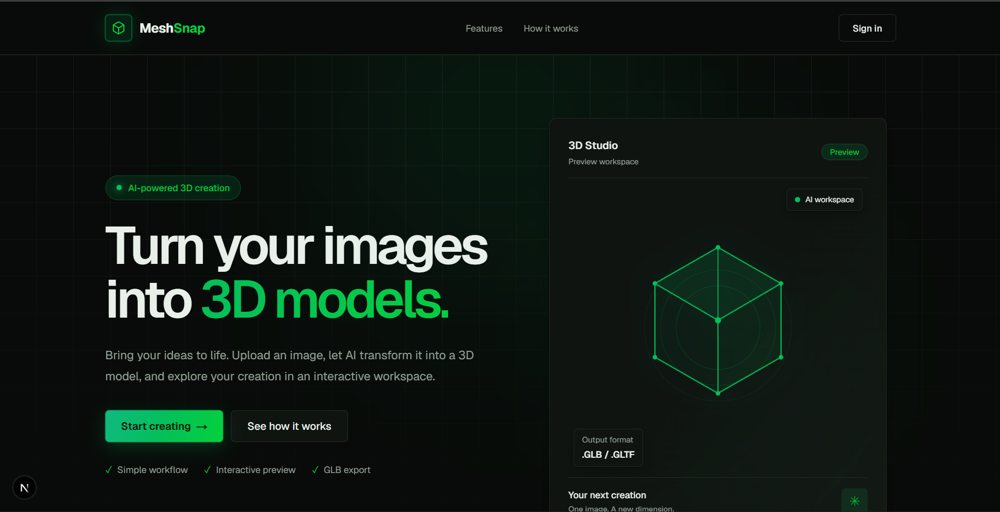
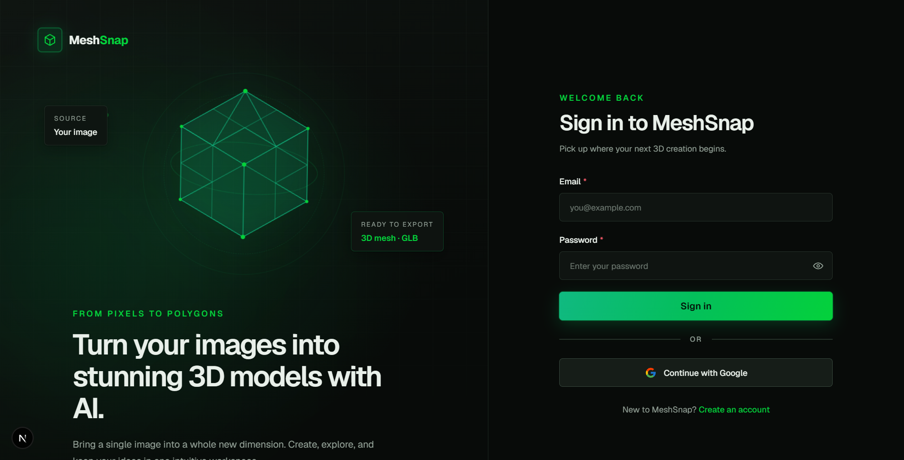
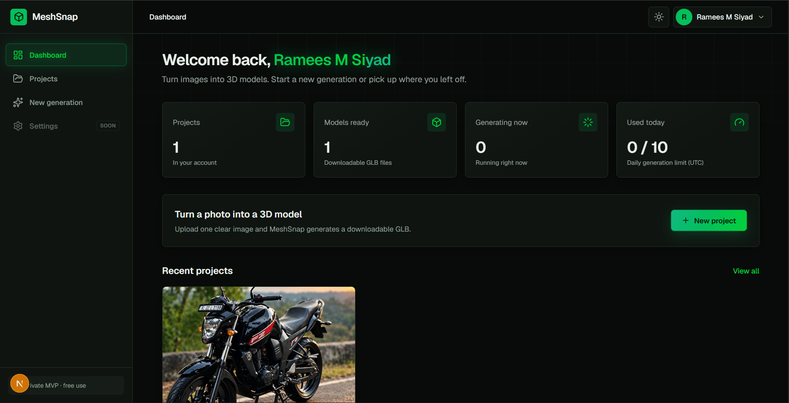
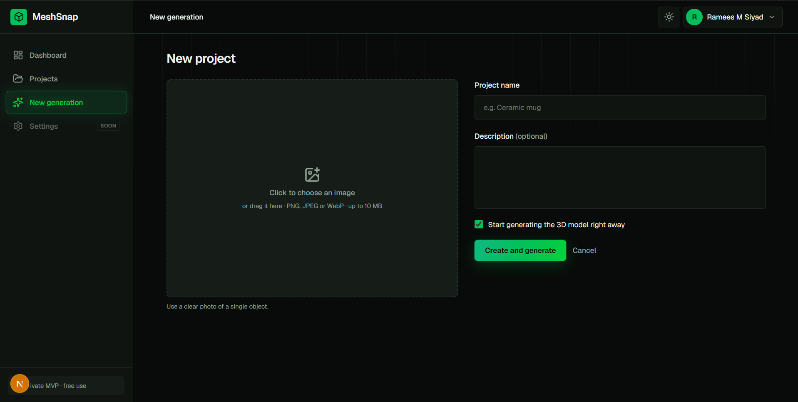
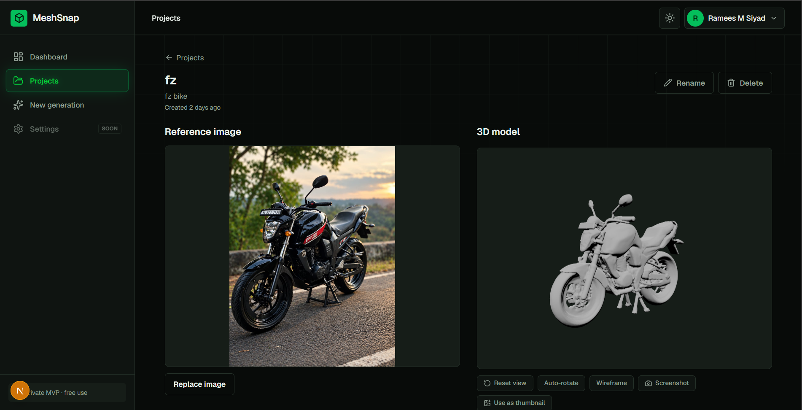

# MeshSnap

**Turn a single photo into a 3D model, right in your browser.**

MeshSnap is a full-stack web app that converts a reference image into a downloadable 3D model using AI. You upload a photo, start a generation, and watch the job progress. When it finishes, you can inspect the model in an interactive 3D viewer, compare versions, and export it for web use or 3D printing.

> **Status:** Phase 1 private MVP, in active development.

---

## Features

### 3D generation
- Image-to-3D generation through a swappable provider layer (mock provider for development, Hugging Face Space running Tencent Hunyuan3D-2, and fal.ai support)
- Asynchronous jobs with live status polling, cancel, retry and regenerate
- Idempotency keys so a double click never creates two jobs
- Per-user daily generation limits
- Automatic recovery of jobs interrupted by a server restart

### Interactive 3D viewer
- Orbit, zoom and pan controls built with React Three Fiber and Three.js
- Wireframe and auto-rotate modes
- Lighting and background presets
- Screenshot export
- Automatic project thumbnails captured from the 3D canvas, or set manually

### Projects and versions
- Create, rename, search and delete projects
- Every generation is kept as a model version, so you can compare and delete versions
- Reference image upload with server-side validation

### Downloads
- Export models as **GLB**, **OBJ** or **STL** (STL and OBJ for 3D printing and other 3D tools)

### Accounts and security
- Email and password accounts with **Argon2id** password hashing
- Server-side sessions with hashed tokens in HTTP-only cookies
- **CSRF** protection (origin check plus per-session token)
- Registration modes: open, invite-only or closed
- Rate limiting on login and registration
- Private file storage: files are never public, and every download goes through an ownership-checked API route

### Interface
- Responsive dashboard with light and dark themes
- Loading, empty and error states throughout

---

## Tech stack

| Layer | Technology |
|---|---|
| Frontend | Next.js (App Router), React, TypeScript, Tailwind CSS |
| 3D | React Three Fiber, drei, Three.js |
| Data and forms | TanStack Query, axios, react-hook-form, Zod |
| Backend | Python, FastAPI, Pydantic |
| Database | PostgreSQL with SQLAlchemy 2 and Alembic migrations |
| Storage | Cloudinary (private, authenticated assets) with a local-disk option for development |
| AI providers | Hugging Face Space (Hunyuan3D-2), fal.ai, mock provider |
| Model export | trimesh |
| Testing | pytest |

---

## Architecture

```
Browser (Next.js)
   │  session cookie + CSRF token
   ▼
FastAPI API  ──►  PostgreSQL (users, sessions, projects,
   │                          jobs, assets, usage records)
   │
   ├──►  Background job runner ──►  AI provider (mock / Hugging Face / fal.ai)
   │
   └──►  Private storage (Cloudinary / local) for images, models, thumbnails
```

1. The user uploads a reference image, which is validated and stored privately.
2. Starting a generation creates a job, and a background task sends the image to the configured provider.
3. The frontend polls the job status. On success, the GLB is stored as a model version and counted against the daily quota.
4. The viewer loads the model through the API, and downloads can be converted to OBJ or STL on the server.

---

## Project structure

```
meshSnap/
├── backend/
│   ├── app/
│   │   ├── api/          # Routes: auth, projects, generation, health
│   │   ├── core/         # Settings and security helpers
│   │   ├── db/           # Database session and base models
│   │   ├── models/       # SQLAlchemy models
│   │   ├── schemas/      # Pydantic request and response schemas
│   │   └── services/     # Generation, storage, sessions, rate limiting,
│   │                     # model export, AI providers
│   ├── alembic/          # Database migrations
│   └── tests/            # pytest suite
└── frontend/
    └── src/
        ├── app/          # Next.js routes (landing, auth, dashboard, projects)
        ├── components/   # UI, dashboard, projects, 3D viewer
        ├── hooks/        # TanStack Query hooks
        └── lib/          # API client and validation
```

---

## Roadmap

- Password reset
- Google sign-in
- Public share links for models
- Multi-image input
- Admin view for approving invited users
- Public deployment

## Screenshots

### Landing page


### Sign in


### Dashboard


### Image upload


### 3D viewer


---

## License

All rights reserved.
